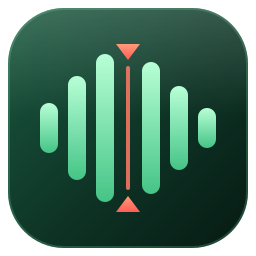

<h1>&nbsp;FlowCut</h1>

A desktop editor for talking-head and screen recordings. Open a recording and FlowCut marks every pause and every
filler word ("um", "uh", a stand-alone "so") as a cut for you to review. You go through it at up to 6× speed, fix what
it got wrong with a few keys, make quiet moments louder, and render in one pass without visible or audible quality
loss.

Electron and plain JavaScript (no build step), Python only for the Whisper transcript. Made by Maksims Sics
([flowbyte.ai](https://flowbyte.ai)). MIT licensed.

## What it does

- **Silences found automatically**: 40 ms loudness windows, an automatic level, short pauses left in, a little padding
  around speech. No sliders: every pause is proposed as a cut and you decide.
- **Filler words** from a Whisper transcript: sounds (um, uh, hmm) always, words (so, like, actually, you know) only when
  they stand alone, so "So, today..." is cut and "it's so good" is not.
- **Review at 1× 2× 4× 6×**, always at the recording's own resolution. "Preview result" skips the cuts; put the playhead
  inside a cut to hear exactly what was cut without bringing it back.
- **Split and toggle**: `S` splits the recording at the playhead, and every piece has a bar at the top of the timeline:
  click it to cut the piece or bring it back.
- **Words on the timeline** (the word being spoken lights up) and **words on the video** like subtitles, so you can
  follow the speech even at 6×.
- **Louder moments**: +3 dB per press on a piece, never clipping.
- **One-encode render** on the GPU (NVENC) when there is one: MP4 with AAC 320 kbps or MOV with lossless 24-bit sound;
  VMAF 99.5 against the source in the measurements below.

## Requirements

- Windows 10 or 11 (FlowCut is developed and tested there).
- [Node.js](https://nodejs.org) 20 or newer.
- [ffmpeg](https://ffmpeg.org) and ffprobe on the PATH. An NVIDIA GPU makes renders and the fast copy much quicker
  (AV1 NVENC, used for the fast copy, needs an RTX 40-series card; other cards get H.264).
- Optional: Python and Whisper for the transcript, filler words and words on the video (next section).

### Transcript and filler words (optional)

FlowCut runs Whisper on your own computer with [faster-whisper](https://github.com/SYSTRAN/faster-whisper): free, no
account, no API key, nothing uploaded. Without it everything else (silence cuts, editing, review, render) still works.

1. Install [Python](https://www.python.org/downloads/) 3.9 or newer and tick "Add python.exe to PATH" (FlowCut looks
   for `python` or `py` on the PATH).
2. Install faster-whisper:
   ```
   pip install faster-whisper
   ```
3. With an NVIDIA graphics card, also install its CUDA libraries, which make Whisper many times faster:
   ```
   pip install nvidia-cublas-cu12 "nvidia-cudnn-cu12==9.*"
   ```
   Without them Whisper runs on the CPU with a smaller model (slower, still free).
4. Open a recording. The first transcription downloads the large-v3-turbo model once (about 1.6 GB, from Hugging Face);
   after that it works offline. The welcome screen shows whether Whisper was found and whether it uses the GPU.

## Run it

```
git clone https://github.com/maksims-sics/flowcut.git
cd flowcut
npm install
npm start
```

- `FlowCut.cmd` starts it as well (and runs `npm install` the first time). A video can be dropped onto it.
- `powershell -ExecutionPolicy Bypass -File build\create-shortcut.ps1` makes `FlowCut.lnk` with the app icon, which
  opens FlowCut like an installed app (add `-Folder Desktop` to put it on the desktop).
- Without the window: `npm run cut -- "C:\Videos\recording.mp4" --render` (`--json` writes the cut list as JSON).

## Reviewing a recording

1. **Open** a recording (button, `Ctrl+O`, drop it on the window, or a recent file). Silences are found in seconds;
   Whisper then transcribes in the background (about 12× real time on an NVIDIA GPU) and the filler words appear as
   violet cuts.
2. **Review** at **1× 2× 4× 6×** (buttons or keys `1 2 4 6`). "Preview result" (`P`) skips the cuts it runs into; turn
   it off to hear everything. Put the playhead inside a cut yourself (click it, `↑` / `↓`, or a row of the Review list)
   and preview plays that cut, then goes on. Sound plays at every speed with natural pitch.
   - **The timeline follows**: while playing, the playhead walks to the middle and stays there while the recording
     slides under it. Paused, the timeline stays where you put it: drag it or use the wheel to look around
     (`Ctrl` + wheel zooms).
   - **Words**: the words lane under the waveform lights up the word being spoken and strikes through the cut ones,
     in two rows when they are tight. **Words on the video** (`C`, the "Words" switch) shows the phrase being spoken,
     the current word lit.
3. **Fix** what is wrong:
   - `S` **splits** the recording at the playhead; nothing is cut by that. Every piece has a **bar** at the top of the
     timeline (green kept, red pause, violet filler word, amber your cut): **click a bar** to cut that piece, click it
     again to bring it back. For a bad take: `S` where it starts, `S` where it ends, click the bar in between.
   - For the piece under the playhead: `O` flips it, `Del` cuts it, `K` brings it back. Double-click in the lanes
     flips a piece too.
   - The **Review** list shows every pause, filler word, your own cuts and louder moments. Click a row to jump 1 s
     before it; `Space` then plays it. Its button brings a cut back or removes a boost.
   - `Ctrl+Z` / `Ctrl+Y` undo and redo everything, splits included.
4. **Louder**: `V` makes the piece under the playhead 3 dB louder (repeat for more, up to +12 dB); split with `S` first
   for a shorter part. `Shift+V` removes the boost. You hear it while reviewing, and the render lowers a boost that
   would push a peak over -0.3 dBFS (and says so).
5. **Render** (`Ctrl+R`): `<name>_flowcut.mp4` next to the recording, never overwriting a file.

Press `?` in the app for every shortcut.

| Key | What it does |
|---|---|
| `Space` | play / pause |
| `1` `2` `4` `6` | speed |
| `P` / `C` | preview the result / words on the video, on and off |
| `↑` / `↓` | previous / next cut |
| `←` / `→`, `Ctrl` + `←` / `→` | one frame, five seconds |
| `S` | split at the playhead |
| click a piece's bar | cut it / bring it back |
| `O` / `Del` / `K` | flip / cut / keep the piece under the playhead |
| `V` / `Shift+V` | 3 dB louder / remove the boost |
| `+` / `-` / `0` | zoom in / out / whole recording |
| `Ctrl+O` / `Ctrl+R` | open / render |

### Filler words

The list of words to cut is editable in the app ("Words to cut"). Sounds (um, uh, ah, hmm) are always cut. Words (so,
like, actually, you know, I mean) only when they stand alone: a pause or punctuation before them and a pause or comma
after, or at the start of a sentence. Each cut edge moves into the quietest 40 ms of the gap next to the word. Whisper
normally drops "um" and "uh"; FlowCut primes it to write them (English). On a 24-minute screen recording that gave 14
filler cuts, while 56 "so" and 50 "actually" inside sentences stayed.

### Why 4× and 6× use a fast copy

The editor window decodes about 100 video frames a second, whatever the resolution. 6× of a 30 fps recording needs 180,
so the original froze for about 2 s every few seconds (about 3.6× on average). The first time you pick 4× or 6×,
FlowCut makes a **fast copy** with the same resolution but 10 frames a second: 6× then needs 60, which is all a 60 Hz
screen shows anyway. The copy is on screen only while playing at 4× or 6×; stop or slow down and the original is back
on the same frame. On a 24-minute 1440p recording it took 92 s to make and played at 5.97×. The three newest fast copies
are kept (about 18 MB per minute each).

### Quality

Measured with `npm run quality` on a 4K AV1 recording, every rendered frame against the same source frame:

| | Picture | Sound |
|---|---|---|
| MP4, Best quality (default) | VMAF 99.5 (min 98.4), PSNR 50.2 dB, SSIM 0.992 | AAC 320k, SNR 45 dB against the source |
| MOV | same | lossless: SNR 119 dB, largest difference -138 dBFS |
| Smaller file | VMAF 98.9, PSNR 48.0 dB | |

VMAF above about 97 is generally indistinguishable from the source. The encoder is NVENC at constant QP 12 (as good as
x264 CRF 12 slow, about 14× faster), with the colour tags copied from the source; 4K camera footage comes out at about
190 Mbps, so plan disk space. Every join has a 4 ms fade so cuts never click.

## Where things live

| What | Where |
|---|---|
| App settings, recent files | `%APPDATA%\FlowCut\settings.json`, `recent.json` |
| Per recording: edits, splits, louder moments, levels, transcript, fast copy, review copy | `%APPDATA%\FlowCut\projects\<id>\` (id = path + size + date) |
| Rendered videos | next to the recording, or the folder chosen under Render |

## How it works

```
 renderer (page, no Node)            preload.js              main process (Node)              engine (plain Node)
 ┌───────────────────────┐   window.flowcut.*   ┌──────────────────────────┐   require   ┌───────────────────────┐
 │ app.js  controller     │ ───────────────────▶ │ ipc.js   API handlers    │ ──────────▶ │ cuts.js    cut rules   │
 │ timeline.js  canvas    │ ◀── 'job' events ─── │ jobs.js  progress/cancel │             │ fillers.js gains.js    │
 │ player.js  review.js   │                      │ store.js %APPDATA% files │             │ analyze.js + worker    │
 │ edits.js shortcuts.js  │                      │ main.js  window          │             │ render.js  one encode  │
 └───────────────────────┘                      └──────────────────────────┘             │ transcribe.js -> python│
                                                                                           └───────────────────────┘
```

- **Engine** (`src/engine`) has no Electron in it: the tests and `src/cli.js` use it directly.
- The page never touches files: everything goes through `window.flowcut` (`src/main/preload.js`).
- Long work runs as **jobs** (`jobs.start(kind, label, fn)`); the page gets `start / progress / done / error /
  cancelled` events.
- **Cut model**, in order: silences (rules on cached 40 ms levels) -> filler words (from the transcript) -> your edits
  `[{start, end, op: 'cut'|'keep'}]`. Louder moments are a separate list `[{start, end, op: 'add', db} | {start, end,
  op: 'reset'}]`. The page sends both lists on every change (`cuts:compute`, a few ms) and gets back segments
  `[{start, end, keep, manual, reason: 'silence'|'filler'|null, text}]`, the louder ranges and the stats.
- **Splits** (`S`) are a third list, in seconds, kept in the page and the project (`splits`) but never sent to the
  engine: `pieces.js` cuts the engine's segments again at every split and at the edges of your edits, and that is what
  the piece bars show and toggle (a toggle adds a `cut` / `keep` edit over exactly that piece). A split alone changes
  nothing in the render: touching kept pieces are rendered in one go, with no join.

### Files

| File | Job |
|---|---|
| `src/main/main.js` | window (custom dark title bar, FlowCut icon), single instance, file from the command line |
| `src/main/ipc.js` | every API channel (table below) and the open / transcribe / render / copy jobs |
| `src/main/jobs.js` | job runner: progress throttling, cancel through AbortController |
| `src/main/store.js` | settings, recent files, project folders under `%APPDATA%\FlowCut` |
| `src/main/preload.js` | the `window.flowcut` bridge |
| `src/engine/tools.js` | find ffmpeg / ffprobe / python, run processes, cancel |
| `src/engine/probe.js` | media facts (container duration, r_frame_rate, the last audio stream's channels) + colour tags |
| `src/engine/analyze.js`, `levels-worker.js` | analysis audio (mono, start offset) + 40 ms levels in a worker thread |
| `src/engine/cuts.js` | **silence rules** (change carefully: `test/engine.test.js` pins them), fillers + edits layering, frame ranges, stats |
| `src/engine/fillers.js` | filler words from the transcript (stand-alone rules, quiet-edge placement) |
| `src/engine/gains.js` | louder moments -> non-overlapping ranges |
| `src/engine/render.js` | one-encode render: `select` for frames, PCM cut with join fades and gains for sound, quality presets |
| `src/engine/transcribe.js`, `python/transcribe_worker.py` | Whisper word timestamps (a verbatim prompt keeps um / uh) |
| `src/engine/proxy.js` | fast copy (same size, 10 fps, for 4× / 6×) and review copy (same size, for files the window cannot play) |
| `src/renderer/js/app.js` | page controller: state, keys, jobs, buttons |
| `src/renderer/js/timeline.js` | the canvas: piece bars, splits, waveform, cuts, fillers, louder, words, zoom, sliding, following the playhead |
| `src/renderer/js/pieces.js` | pieces = engine segments split again at your splits and edit edges |
| `src/renderer/js/captions.js` | words on the video: the phrase being spoken, the current word lit, cut words struck through |
| `src/renderer/js/player.js` | the original + fast copy elements, speeds, preview skipping (and playing a cut you chose), louder-moment gain (Web Audio) |
| `src/renderer/js/review.js` | the Review list |
| `src/renderer/js/edits.js` | undo / redo over edits, louder moments and splits |
| `src/renderer/js/shortcuts.js` | keyboard table (also the help screen) |
| `src/renderer/styles/app.css` | design tokens at the top (`--accent`, `--cut`, `--filler`, `--gain`...) |
| `build/icon.svg`, `icon-small.svg`, `make-icon.js` | the app icon; `node build/make-icon.js` rebuilds `icon.ico` |
| `build/create-shortcut.ps1` | makes `FlowCut.lnk` |
| `src/cli.js` | command-line cut / render |

### API (`window.flowcut`)

| Call | Channel | Returns |
|---|---|---|
| `info()` | `app:info` | tools found, NVENC, Whisper status, app settings |
| `saveAppSettings(patch)` | `app:settings:save` | settings (fillers, render, transcript, view...) |
| `openProject(path)` | `project:open` | job id; `done` result = project snapshot |
| `levels(id)` | `project:levels` | Float32Array of 40 ms levels (dB) |
| `compute(id, {edits, gainEdits})` | `cuts:compute` | `{segments, gains, stats, level}` |
| `saveProject(id, {edits, gainEdits, splits})` | `project:save` | |
| `transcribe(id, {language, vocabulary})` / `transcript(id)` | `transcribe:start` / `transcript:get` | job id / words |
| `render(id, {edits, gainEdits, render: {format, quality}})` | `render:start` | job id; result `{outPath, frames, seconds, pieces, encoder, gains}` |
| `makeFast(id)` / `makeProxy(id)` | `fast:make` / `proxy:make` | job id; result `{projectId, fastUrl}` / `{projectId, mediaUrl}` |
| `cancelJob(jobId)`, `reveal(path)`, `openPath(path)`, `recent()`, `pickVideo()`, `chooseFolder()` | | |
| `onJob(cb)`, `onOpenFile(cb)` | events | unsubscribe function |

## Adding a feature

Run the checks after every change: `npm test` and `npm run e2e` (and `npm run quality -- "<a recording>"` when
touching the render).

**A new automatic cut** (example: repeated phrases and retakes from the transcript): write a finder like
`src/engine/fillers.js` that returns `[{start, end, text}]`, overlay it in `computeCuts` next to `applyFillers` with its
own `reason`, add a colour in `timeline.js` and a tab in `review.js`. Unit-test it in `test/engine.test.js`.

**A new job** (example: batch render a folder): an engine function taking `{signal, onProgress, onStatus}`, a handler
in `ipc.js` (`return jobs.start('batch', label, async ({signal, progress, status}) => ...)`), exposed in `preload.js`,
and `m.kind === 'batch'` handled in `onJob` in `app.js`.

**A new export** (Premiere XML, EDL...): a converter from `segments` in `src/engine/`, a channel in `ipc.js`, a button
in `index.html`.

Good next features: retake suggestions, exports for other editors, batch processing, an installer (electron-builder).

## Tests

| Command | What it proves |
|---|---|
| `npm test` | silence rules, filler rules, louder ranges, edits, frame ranges, render expression |
| `npm run e2e` | the real app on generated clips: speeds and the fast copy (same size, 10 fps, original back on stop), the whole frame fits the stage, `S` splits without cutting, a click on a piece's bar cuts it and another brings it back, `Del` / `K` / `O` on the piece under the playhead, double-click, dragging slides (no selection), `V` louder on a piece (+3 dB measured in the render), review rows and clicks play the cut, preview skips the rest, the playhead stays in the middle, words on the video, MP4 + MOV renders, 4K stays 4K, an unplayable 4K MKV gets a same-size copy. `-- --file "<recording>" --transcribe` adds a real file and Whisper. Screenshots go to `test/artifacts/` |
| `npm run quality -- <file> [--format mov]` | renders like the app and scores picture (VMAF / PSNR / SSIM) and sound (SNR) against the source |

## Known limits

- FlowCut cuts; there is no fast-forward or transition mode.
- 4× and 6× wait for the fast copy the first time (about 1.5 min for 24 minutes of 1440p); until then they play the
  original, which freezes now and then.
- Audio is analysed in 45-minute chunks; tested on recordings of up to 24 minutes.
- Audio-only files: the analysis works, the render needs a video stream.
- Filler words need Python and faster-whisper; the prompt that keeps um / uh is English only.

## License

[MIT](LICENSE) © 2026 Maksims Sics
